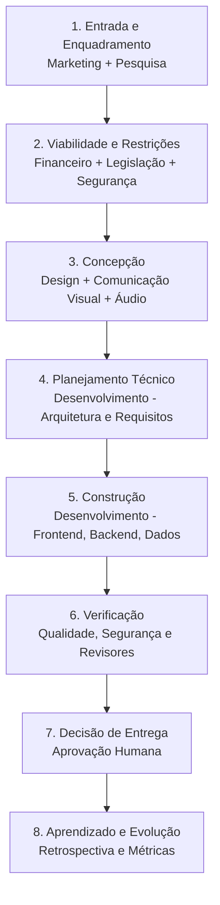

# Fluxo de Trabalho do Ecossistema

O ciclo padrão de entrega é composto por 8 etapas iterativas:

### Detalhamento das Etapas:
1. **Entrada e enquadramento:** Marketing + Pesquisa definem problema, público, contexto e evidências.
2. **Viabilidade e restrições:** Financeiro + Legislação + Segurança avaliam custos, obrigações e riscos.
3. **Concepção:** Design + Comunicação Visual + Áudio definem experiência e linguagem conforme a necessidade do projeto.
4. **Planejamento técnico:** Desenvolvimento converte requisitos aprovados em arquitetura, tarefas e critérios de aceitação.
5. **Construção:** Desenvolvimento implementa; os núcleos especialistas fornecem conteúdo e revisões.
6. **Verificação:** Segurança, Pesquisa e os agentes revisores validam qualidade, evidências, usabilidade e conformidade.
7. **Decisão de entrega:** o responsável humano do projeto avalia riscos residuais, custos, qualidade e prontidão.
8. **Aprendizado:** registrar métricas, problemas, decisões e melhorias para a próxima versão.
